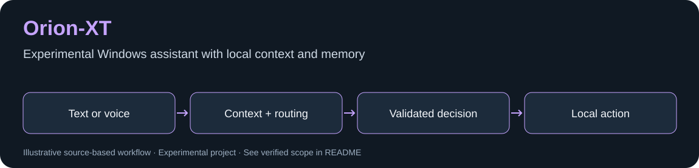

# Orion-XT


*Diagrama baseado no código; não representa uma captura da interface nem comprova execução de modelo.*


Assistente experimental para Windows com contexto, memória em SQLite, entrada de texto e integrações opcionais de voz e Ollama. Esta publicação incorpora a versão local `0.8 academic context stable`; a pasta `OrionXT_V2` local é apenas uma estrutura vazia e não substitui esta base.

## Instalação inicial / First run

No Windows, com Python 3.11+ instalado, clone o projeto e prepare um ambiente isolado:

```powershell
git clone https://github.com/Michaliszyn01/Orion-XT.git
cd Orion-XT
py -3 -m venv .venv
```

```powershell
.\.venv\Scripts\python.exe -m pip install -r requirements.txt
.\.venv\Scripts\python.exe main.py
```

**Pré-requisitos adicionais:** Ollama com o modelo configurado no código (`gemma3:4b` nesta revisão), bibliotecas de áudio e recursos locais de voz. O ponto de entrada inicializa voz mesmo quando você pretende digitar; portanto, não há um modo texto independente dessas dependências validado nesta versão. O primeiro uso pode exigir downloads de modelos. Não é uma distribuição pronta com tudo incluído.

Uma entrada não vazia usa texto; Enter vazio solicita áudio; `sair` encerra o loop. Não teste comandos de automação em arquivos importantes. Veja [uma demonstração isolada da memória](docs/DEMO.md), que não abre aplicativos nem chama um modelo.

## Executar

Use Python 3.11+, instale `requirements.txt` em um ambiente virtual e execute `python main.py`. Voz exige microfone, dependências de áudio e modelos locais. Revise as ações disponíveis antes de usar a automação no computador.

Os dados pessoais, memórias anteriores e bancos SQLite não acompanham a publicação. O código gera dados locais na primeira execução. Não há garantia de compatibilidade de áudio ou autonomia contínua nesta revisão.

## English

An experimental Windows assistant with context, local memory and optional speech/Ollama integrations. This is the existing local v0.8 codebase, not the empty V2 scaffold. Personal databases and conversation history are excluded.
